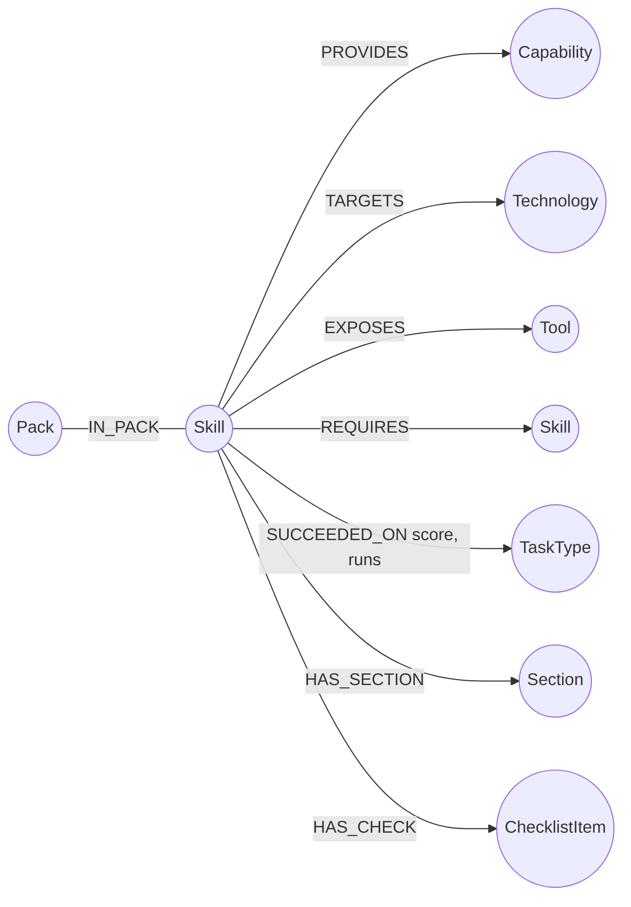
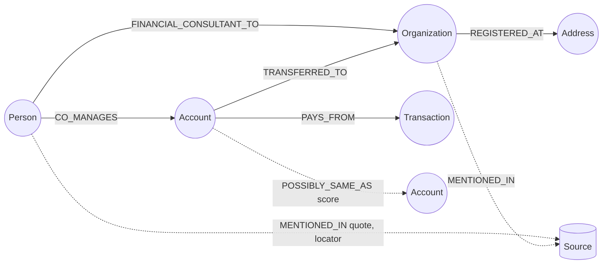
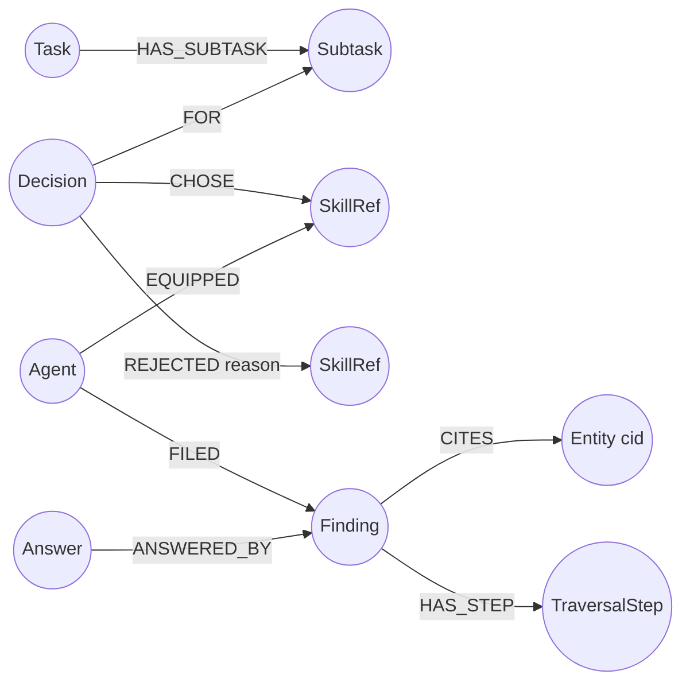
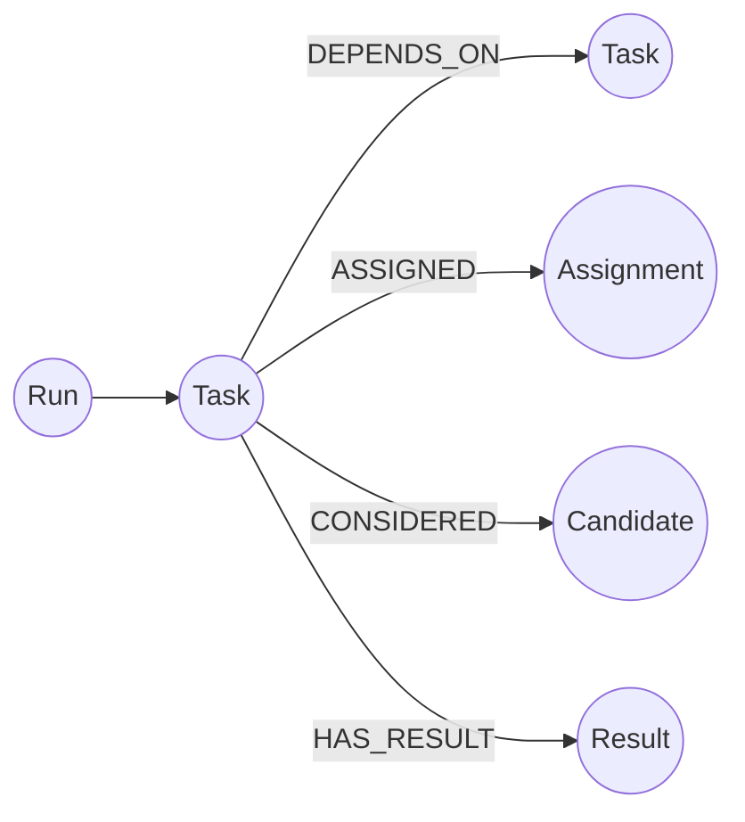
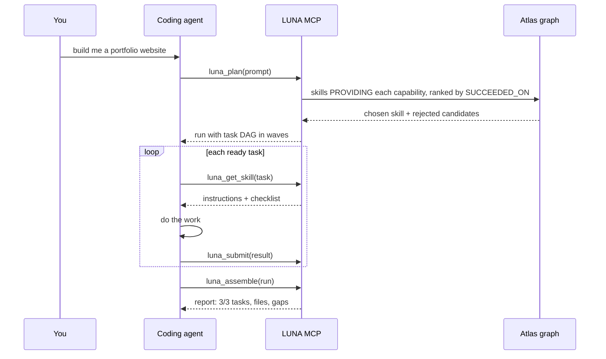

# LUNA OS

**A graph-native platform for AI agents.** LUNA does two things, both backed by one FalkorDB graph:

1. **Cases** - paste or upload messy data, LUNA builds a context graph from it, and sub-agents answer questions by walking that graph. Every answer comes with citations, a replayable trace and an honest "not checked" list.
2. **Forge (MCP)** - any coding agent (Claude Code, Antigravity) connects to LUNA over MCP. LUNA plans a build request as a task graph, picks a skill for each task from a skill graph, and the agent does the work and reports back. New skills wait for human review.

> Stack: Python 3.11 / FastAPI / FastMCP, FalkorDB (Cypher), React + Vite + Cytoscape UI, any OpenAI-compatible, Anthropic, Gemini or Ollama model.

## Contents

- [Quick start](#quick-start)
- [Configuration and checking your LLM key](#configuration-and-checking-your-llm-key)
- [The graph map](#the-graph-map) - nodes, relationships and how agents query them
- [How it reasons](#how-it-reasons) - multi-hop, graph tools, MCP tool selection, actions, explainability
- [Using it](#using-it)
- [Project layout](#project-layout)
- [Tests and checks](#tests-and-checks)
- [Security](#security)

---

## Quick start

Requirements: Python 3.11+, Node 18+, Docker (for FalkorDB), and a model endpoint with an API key (or a local Ollama).

```bash
git clone https://github.com/mohit230723/LUNA.git
cd LUNA

# 1. Graph database
docker compose up -d                     # FalkorDB on localhost:6379

# 2. Backend
python -m venv .venv
source .venv/bin/activate                # Windows: .venv\Scripts\activate
pip install -e .
cp .env.example .env                     # then edit the LUNA_LLM_* lines (next section)
python -m uvicorn luna.api.app:app --host 127.0.0.1 --port 8000

# 3. UI (second terminal)
cd ui && npm install && npm run dev      # http://localhost:5173
```

Open http://localhost:5173 and choose **Platform**. The nav badge reads **BACKEND ONLINE** when the API, FalkorDB and the model are reachable (`GET /api/health`).

## Configuration and checking your LLM key

All model settings live in `.env` (git-ignored). The backend reads it at startup, so restart it after any change.

```bash
LUNA_LLM_PROVIDER=openai_compatible      # ollama | openai_compatible | anthropic | gemini
LUNA_LLM_BASE_URL=https://api.openai.com/v1
LUNA_LLM_MODEL=gpt-4o-mini
LUNA_LLM_API_KEY=<your key>
LUNA_LLM_TIMEOUT_S=120
```

Examples: a local gateway such as OmniRoute uses `LUNA_LLM_BASE_URL=http://localhost:20128/v1` and a model or combo name from `GET /v1/models`. Anthropic and Gemini use their own provider value and key. Local Ollama needs no key.

Check the key and endpoint in one command (it never prints the key):

```bash
python scripts/check_llm.py              # provider, model, base URL, one test completion
```

Then check both features end to end:

```bash
python scripts/check_cases_flow.py       # builds a graph from the demo brief and answers a question (1-2 min)
python scripts/forge_smoke.py --url http://127.0.0.1:8000/mcp   # MCP plan, claim, submit, assemble: ends with SMOKE OK
```

If the model is unreachable or the key is wrong, the Cases build and questions fail with a clear provider error rather than a silent empty graph, and the health badge shows the model as unreachable. The MCP smoke test does not need a model, only FalkorDB.

---

## The graph map

LUNA keeps several FalkorDB graphs. Each has one job.

| Graph | Holds | Written by |
|---|---|---|
| `atlas` | The skill library: skills, capabilities, technologies, tools, policy, track record | seed data, Forge skill import, run learning |
| `ctx_<case>` | One case's context graph: entities, relationships, source quotes | Cases ingest |
| `run_<id>` | One run's memory: plan, decisions, findings, traversal steps | investigation pipeline |
| `conversations` | Case threads, turns, links to runs | Cases and chat |
| Forge run graph | Build runs: task DAG, assignments, candidates, results | MCP tools |

### Atlas: skills and the evidence for choosing them



A skill has `restricted`, and imported skills carry `source` and a review `status` (`pending`, `approved`, `rejected`). `SUCCEEDED_ON.score` is an exponential moving average updated after approved runs.

### Context graph: what a case contains

The model proposes entities, and every one is verified against an exact quote in the source before it is loaded.



Node types: Person, Organization, Account, Transaction, Address, Location, Phone, Email, Device, Event, Document, Asset. Relationship names are chosen by the extractor from the text (examples above come from the demo brief). Every node has a stable `cid`, duplicates are merged by entity resolution, and weak matches become `POSSIBLY_SAME_AS` instead of being merged silently.

### Run memory: why the agents did what they did



### Forge runs: build plans over MCP



---

## How it reasons

### Multi-hop reasoning

A question such as "Who is connected to account ACC-9821 and how are they linked to Apex Holdings?" is not answered by one lookup. The investigation pipeline:

1. **Route and seed** - detect the entities named in the question and resolve them to `cid`s in the case graph.
2. **Plan** - split the question into sub-tasks, each needing a capability (trace relationships, find shared attributes, detect clusters, build a timeline, check sources, ask the graph).
3. **Walk** - each sub-agent runs a bounded tool loop over its own private slice of the graph, hopping outward from the seeds (up to three hops) and reading the edges it finds.
4. **Verify** - a finding is kept only if every entity it cites actually appeared in that agent's own tool output. Findings that cite unseen evidence are rejected with the reason `evidence_not_observed`.
5. **Compose** - the answer is written from verified findings only, with a confidence score and a list of what was not checked.

For the demo brief the walk finds `ACC-9821 -TRANSFERRED_TO-> Apex Holdings LLC` directly, and a second path through a person who co-manages the account and consults for the company.

### Graph queries and algorithms as agent tools

Agents never get raw database access. They get a small set of read-only tools, and the skill they are equipped with decides which ones they may call.

| Skill | Capability | Tools | What the tool does |
|---|---|---|---|
| Relationship Tracer | trace_relationships | `neighbors`, `paths_between`, `shortest_path` | Cypher variable-length path search `(a)-[*1..n]-(b)`, ranked by length and confidence |
| Shared Attribute Finder | find_shared_attributes | `shared_attributes`, `common_neighbors` | Pattern `(a)-[]->(x)<-[]-(b)` for shared accounts, phones, addresses |
| Cluster Detector | detect_clusters | `cluster_of`, `central_nodes` | Connected components (BFS / union-find) and degree centrality |
| Timeline Builder | build_timeline | `timeline` | Dated events around an entity in order |
| Source Checker | check_sources | `source_mentions` | The exact quote and locator behind a claim |
| Graph QA | query_graph | `ask_graph` | Model-written read-only Cypher, validated before it runs |

Tool names given to a model are resolved against real `cid`s, so a shortened or mistyped id still lands on the right node.

### Tool selection through MCP

There are two layers of tool selection.

**Which skill gets a task** is a graph query, not a model guess. For each sub-task, the Atlas is asked for skills that `PROVIDE` the needed capability, drops restricted skills and unapproved imports, checks `REQUIRES` prerequisites, and ranks the rest by `SUCCEEDED_ON` score. The winner is recorded as `Decision -CHOSE-> Skill`, and each loser as `Decision -REJECTED {reason}-> Skill`.

**Which tool the agent calls** is limited by its skill's `EXPOSES` edges. In Forge, the coding agent talks to LUNA through six MCP tools at `http://localhost:8000/mcp` (Streamable HTTP):

| MCP tool | Purpose |
|---|---|
| `luna_plan` | Turn a request into a run with a task DAG in dependency waves |
| `luna_get_skill` | Claim a task and fetch its skill (instructions, checklist, references) |
| `luna_submit` | Report a task's result: summary, files, checklist checks |
| `luna_assemble` | Combine all results into one report: tasks, files, gaps |
| `luna_search_skills` | Search the skill graph by text |
| `luna_add_skill` | Propose a `SKILL.md`; it stays `pending` until a person approves it |

It also exposes a `luna-build` prompt that gives the agent the playbook.



### Actions based on what the graph shows

Graph results drive concrete next steps, with a human in the loop wherever something changes:

- **Skill assignment** - the winning skill, and the equipped agent, are written into the run graph before any work starts.
- **Task ordering** - `DEPENDS_ON` edges become waves; a task is released only when its dependencies are done.
- **Review gate** - a skill uploaded in the UI or added over MCP is stored as `pending` and is never assigned until a person approves it in **Platform -> Skills**.
- **Approval-gated actions** - investigation runs can propose actions (for example flag an entity for review). They stay pending until `POST /api/runs/{id}/actions/{action_id}/approve` is called with an approver name.
- **Learning** - approved runs update `SUCCEEDED_ON` scores, so better skills win next time.

### Explainable results

Nothing is a black box, and the explanation is stored in the graph, not generated afterwards.

- **Citations** - every claim in an answer links to real entities in the case graph.
- **View trace** - replays the investigation hop by hop. Every edge in the path carries the quote from the source text that supports it.
- **Why** - shows the evidence chain behind one finding.
- **Not checked** - the answer states what the agents did not cover, such as hop limits.
- **Why this skill** - for any task, shows the chosen skill and the rejected candidates with reasons.
- **Assembly report** - for builds: tasks, files, checklist results and gaps.

---

## Using it

### Cases

1. **Platform -> Cases -> New case**, paste text (or upload a file), **Add to case**.
2. **Build context graph** (Parse, Extract, Resolve, Load). The demo brief is `demo/silverline_brief.txt`.
3. Ask a question and watch the live pipeline: Routed, Planned, Skills assigned, Agents working, Verified, Answer.
4. Open **View trace** or **Why** on the answer.

### Connect a coding agent

```bash
# Claude Code
claude mcp add --transport http luna http://localhost:8000/mcp
```

Antigravity: add `{"mcpServers": {"luna": {"serverUrl": "http://localhost:8000/mcp"}}}` to its MCP config. Then run the `luna-build` prompt with a request such as "build me a portfolio website with React" and watch **Platform -> Agents**. To require a token, set `LUNA_MCP_TOKEN` and send it as a bearer token.

### Add skills

**Platform -> Skills -> Add a skill**, upload a `SKILL.md` (`demo/sample-skill/SKILL.md` is an example). Approve it in the review queue to make it assignable. The **Skill Atlas** page shows the whole skill graph.

A full walkthrough with timings is in [docs/DEMO.md](docs/DEMO.md), and the 4-minute video script is in [docs/VIDEO_SCRIPT_4MIN.md](docs/VIDEO_SCRIPT_4MIN.md).

---

## Project layout

```
luna/
  api/            FastAPI app, REST + SSE endpoints
  forge/          MCP server, run planner, skill import, assembly
  atlas/          skill graph seed, assignment, learning
  cases/          case store and workspace API
  ingest/         parse, extract, resolve, load into the context graph
  investigate/    investigation pipeline, graph tools, trace recorder
  llm/            provider clients (OpenAI-compatible, Anthropic, Gemini, Ollama)
  graph/          FalkorDB store and schema constants
ui/               React + Vite + Cytoscape front end
skills/           bundled SKILL.md library
demo/             demo brief and sample skill
scripts/          check_llm, check_cases_flow, forge_smoke
docs/             demo guide, graph schema, video script
```

## Checks

```bash
python scripts/check_llm.py              # model key and endpoint
python scripts/check_cases_flow.py       # Cases end to end (1-2 min)
python scripts/forge_smoke.py --url http://127.0.0.1:8000/mcp   # MCP end to end, ends with SMOKE OK
```

## Security

- API keys are read server-side from `.env` or the environment. They are never logged, returned by the API or stored in graphs, and `.env` is git-ignored.
- The REST API has no login and is meant for a developer workstation. Do not expose it publicly as is. The MCP endpoint can require a bearer token (`LUNA_MCP_TOKEN`).
- A skill is text injected into an agent prompt, so uploaded or MCP-added skills are held for review and never assigned automatically. Agent graph tools are read-only.
